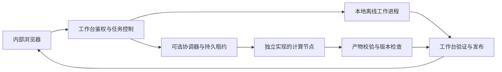

# 架构与可选计算节点

工作台负责检查所有权和面向用户的发布。协调器规划阶段依赖、资源准入与
租约；节点主动领取匹配工作，返回产物供校验。结果与任务版本、租约状态及
输入哈希关联，不能以过期计算覆盖新检查。

## 默认范围

`config.example.json` 不配置集群，仍走本地工作流。
本仓库包含通用 Python 协调器、网关、签发器、工作台桥接及合成测试；
**不包含 Windows 原生节点客户端、私有宿主、引擎包、签名密钥或模型权重。**
节点接入需要实现本工程协议、独立准备资源，并验证兼容性。
公开基础工程使用自己的通用命名空间，不能直接推定与其他客户端互通。

## 网关与签发

`python -m cluster.server --help` 查看 TLS/mTLS 网关所需的证书与目录参数。
`python -m cluster.signer --help` 查看独立签发器参数。签发器持有私钥，网关仅
接收节点 CA 公钥证书；实际证书、CA、SAN、信任关系必须自行配置。

另有 `cluster.lan_server` 的显式 HTTP 兼容入口，需要指定监听地址和允许网段。
它不提供 TLS，不能作为一般网络上的安全部署默认值。

## 工作台桥接与回退

本地 `cluster` 配置需要数据库、产物目录、引擎清单以及策略设置。
无节点可匹配、远程排队超时等情形可按本地策略回退；有活动租约的任务不应
被误判为无节点。取消与删除会使相应远程状态失效。

协调器测试验证协议和工程边界，不证明真实节点、跨机性能或神经网络解剖精度。
启用前必须完成自己的证书、撤销、回传、资源与中断恢复验收。
